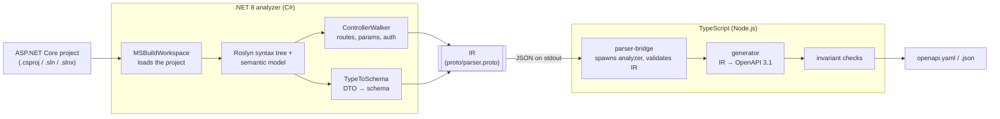

# ASTronaut

**Generate an OpenAPI 3.1 spec from ASP.NET Core source code with static analysis. You don't run the app or start a server, and no AI is involved.**

ASTronaut is a CLI. It reads a controller-based ASP.NET Core project with Roslyn, works out the routes, parameters, request and response types, and auth requirements, and writes an OpenAPI 3.1 document as YAML or JSON.

```bash
node apps/cli/dist/bin.js analyze ./src/MyApi -o openapi.yaml
```

## Why

The usual ways to get an OpenAPI document for an ASP.NET Core API, such as Swashbuckle, NSwag, or `Microsoft.AspNetCore.OpenApi`, all inspect the API at runtime. You need a compiled assembly that starts up: configuration loaded, dependency injection wired, sometimes a database reachable. ASTronaut only needs the source:

- **No startup.** It never runs your `Program.cs`, so it doesn't need connection strings, secrets, or external services. That makes it practical in CI, in pre-commit checks, or on a repo you just cloned.
- **No changes to the target project.** You don't add a NuGet package or Swagger middleware to the API you're documenting.
- **Deterministic output.** The same source produces the same file, ordered consistently, so the spec diffs cleanly in pull requests.
- **Pipe-friendly.** The spec goes to stdout and all progress and warnings go to stderr. `--strict` turns problems into a non-zero exit code.

## How it works



1. **The CLI** (`apps/cli`) finds the project file and starts the .NET analyzer as a child process.
2. **The analyzer** (`analyzers/dotnet`, C#) opens the project through `MSBuildWorkspace`, so it sees the same compilation as the compiler: references, global usings, and nullable context. It then walks the Roslyn semantic model for controllers and DTOs.
3. **The IR** is defined once in [`proto/parser.proto`](proto/parser.proto), and types are generated from it for both sides: C# through `Grpc.Tools` during `dotnet build`, TypeScript through `buf generate`. The analyzer writes the IR as proto3 JSON on stdout. The TypeScript side parses it and validates it (`checkIR`) before using it.
4. **The generator** (`packages/generator`) maps the IR to an OpenAPI 3.1 document. It runs OpenAPI invariant checks (unique operation IDs, path parameters that match the template, resolvable `$ref`s, defined security schemes, and 3.1-style nullability) and serializes the result.

The project is split into two runtimes because Roslyn is the most accurate way to understand C#, while Node has a mature ecosystem for working with OpenAPI. The protobuf contract keeps the two sides in sync.

## Example

Input: a controller and two DTOs in a project with `<Nullable>enable</Nullable>`. `Program.cs` registers `JsonStringEnumConverter`.

```csharp
[ApiController]
[Route("api/[controller]")]
[Authorize]
public class TodosController : ControllerBase
{
    /// <summary>Lists todo items.</summary>
    /// <param name="page">1-based page number.</param>
    [HttpGet]
    [AllowAnonymous]
    public ActionResult<List<TodoItem>> List([FromQuery] int page = 1) => Ok(new List<TodoItem>());

    /// <summary>Gets a single todo item.</summary>
    [HttpGet("{id:int:min(1)}")]
    public IActionResult Get(int id)
    {
        if (id > 100) return NotFound();
        return Ok(new TodoItem { Id = id, Title = "x" });
    }

    [HttpPost]
    public IActionResult Create([FromBody] CreateTodoRequest request) =>
        CreatedAtAction(nameof(Get), new { id = 1 }, new TodoItem { Id = 1, Title = request.Title });

    [HttpDelete("{id:int}")]
    public async Task Delete(int id) => await Task.CompletedTask;
}

public enum Priority { Low, Normal, High }

public class TodoItem
{
    public int Id { get; set; }
    public required string Title { get; set; }
    public string? Notes { get; set; }
    public Priority Priority { get; set; }
    public DateTime? DueAt { get; set; }
}

public class CreateTodoRequest
{
    [Required, StringLength(120, MinimumLength = 3)]
    public string Title { get; set; } = "";

    [Range(0, 10)]
    public int Effort { get; set; }

    public Priority Priority { get; set; } = Priority.Normal;
}
```

Output from `node apps/cli/dist/bin.js analyze ./TodoApi -o openapi.yaml`. This is an excerpt from a real run: the `List` and `Delete` operations and the `CreateTodoRequest` schema are left out.

```yaml
openapi: 3.1.0
info:
  title: TodoApi
  version: 1.0.0          # read from <Version> in the .csproj
paths:
  /api/Todos:
    post:
      responses:
        "201":
          description: Created
          content:
            application/json:
              schema:
                $ref: "#/components/schemas/TodoItem"
      tags:
        - Todos
      operationId: Create
      requestBody:
        content:
          application/json:
            schema:
              $ref: "#/components/schemas/CreateTodoRequest"
        required: true
      security:
        - bearerAuth: []
  /api/Todos/{id}:
    get:
      responses:
        "200":
          description: OK
          content:
            application/json:
              schema:
                $ref: "#/components/schemas/TodoItem"
        "404":
          description: Not found
      tags:
        - Todos
      summary: Gets a single todo item.
      operationId: Get
      parameters:
        - name: id
          in: path
          schema:
            type: integer
            format: int32
            minimum: 1
          required: true
      security:
        - bearerAuth: []
components:
  schemas:
    TodoItem:
      type: object
      properties:
        id:
          type: integer
          format: int32
        title:
          type: string
        notes:
          type:
            - string
            - "null"
        priority:
          type: string
          enum:
            - Low
            - Normal
            - High
        dueAt:
          type:
            - string
            - "null"
          format: date-time
      required:
        - id
        - title
        - priority
  securitySchemes:
    bearerAuth:
      type: http
      scheme: bearer
      bearerFormat: JWT
tags:
  - name: Todos
```

The output above shows several inferences:

- The `{id:int:min(1)}` route constraint becomes `integer` with `minimum: 1`.
- The `200` and `404` responses come from the `return Ok(...)` and `return NotFound()` statements in the method body.
- `CreatedAtAction(...)` produces `201`.
- `string?` and `DateTime?` become OpenAPI 3.1 `type: [T, "null"]`, without the old `nullable: true` keyword.
- The enum is emitted as strings because the project registers `JsonStringEnumConverter`.
- `[AllowAnonymous]` on `List` removes the controller-level security requirement for that operation.

## Prerequisites

| Tool | Version | Source |
| --- | --- | --- |
| .NET SDK | 8.0 (8.0.100 or later; a newer SDK alone is not enough) | `global.json`: `8.0.100`, `rollForward: latestFeature` |
| Node.js | 20 or later | `engines` in `package.json` |
| pnpm | 10.33.0 | `packageManager` in `package.json`, so `corepack enable` works |

You need the full **SDK**, not just the runtime, because the analyzer loads target projects through MSBuild.

The analyzer is a .NET 8 app. It has been run against both `net8.0` and `net10.0` target projects, with a .NET 10 SDK installed alongside .NET 8.

## Build

```bash
pnpm install
pnpm build
```

`pnpm build` publishes the analyzer to `analyzers/dotnet/dist/` and then compiles the TypeScript packages. The other scripts in the root `package.json` are:

| Script | What it does |
| --- | --- |
| `pnpm build:analyzers` | Publishes only the .NET analyzer |
| `pnpm build:ts` | Builds only the TypeScript packages (the analyzer must already be in `dist/`) |
| `pnpm gen:proto` | Regenerates the TypeScript IR types from `proto/parser.proto` |
| `pnpm clean` | Removes the TypeScript build output |

On Windows, if PowerShell blocks `pnpm` with an execution-policy error, use `pnpm.cmd`.

## Usage

There's no npm package yet, so you run the CLI from a clone:

```bash
node apps/cli/dist/bin.js analyze <path> [options]
```

`<path>` can be a project directory, a `.csproj`, a `.sln`, or a `.slnx`. If you pass a directory, ASTronaut prefers a solution file over a project file. When there are several candidates, it picks the first in ordinal path order and prints a warning. To target one project in a multi-project folder, pass its `.csproj` explicitly.

| Option | Description |
| --- | --- |
| `-o, --output <file>` | Write the spec to a file instead of stdout. Parent directories are created. |
| `--json` | Emit JSON instead of YAML |
| `--strict` | Exit non-zero on error diagnostics, duplicate routes, or OpenAPI invariant violations. Warnings alone don't fail. |
| `--title <title>` | Override `info.title` (default: `<AssemblyName>` from the `.csproj`, or the file name) |
| `--version-tag <version>` | Override `info.version` (default: `<Version>` from the `.csproj`, or `0.0.0`) |

Examples:

```bash
# YAML to a file
node apps/cli/dist/bin.js analyze ./src/MyApi/MyApi.csproj -o openapi.yaml

# JSON to stdout, piped elsewhere; diagnostics stay on stderr
node apps/cli/dist/bin.js analyze ./src/MyApi --json > openapi.json

# Fail a CI job on analyzer errors or an invalid spec
node apps/cli/dist/bin.js analyze ./MySolution.sln --strict -o openapi.yaml
```

For development, `pnpm cli analyze <path>` runs the CLI from source through `tsx`, so you don't have to run `tsc` first. Keep these points in mind:

- It runs with `apps/cli` as the working directory, so pass an **absolute** path.
- pnpm prints its own banner to stdout, so use `-o` rather than redirecting stdout.
- It doesn't build the analyzer. Run `pnpm build:analyzers` first.

**Exit codes:**

- `0`: success.
- `1`: one of these:
  - No project was found.
  - The analyzer failed or returned invalid output.
  - No routes were found.
  - A `--strict` check failed.
- `2`: the analyzer DLL wasn't found or a fatal CLI error occurred.

**Tip:** if the target project uses NuGet packages, run `dotnet restore` on it first. Without a restore, types from packages can't be resolved, and DTO properties that use them degrade to plain `object` schemas without a warning.

## What's supported

**Discovery**
- Controllers are non-abstract classes that derive from `ControllerBase` or `Controller`, or that carry `[ApiController]`.
- Public action methods are collected, including ones inherited from base controller classes.
- `[NonAction]` and `[ApiExplorerSettings(IgnoreApi = true)]` are skipped.
- Open generic controllers are skipped with warning `W004`.
- Inputs can be a `.csproj`, `.sln`, or `.slnx`. Only C# projects are analyzed.

**Routing**
- Routes come from a class-level `[Route]` combined with `[HttpGet]`, `[HttpPost]`, `[HttpPut]`, `[HttpDelete]`, `[HttpPatch]`, `[HttpHead]`, `[HttpOptions]` and `[AcceptVerbs]` templates.
- The `[controller]` and `[action]` tokens are replaced. A method template that starts with `/` overrides the class route.
- Route constraints `int`, `long`, `float`, `double`, `decimal`, `bool`, `datetime`, `guid`, `alpha`, `min`, `max`, `range`, `minlength`, `maxlength`, `length` and `regex` become types and JSON Schema constraints.
- Optional (`{id?}`), default-value (`{id=1}`) and catch-all (`{*path}`) segments are normalized.
- API versioning: `[ApiVersion]` combined with a `{version:apiVersion}` route segment expands into one path per version. `[MapToApiVersion]` narrows the versions for a single action.

**Parameters and bodies**
- `[FromRoute]`, `[FromQuery]`, `[FromHeader]`, `[FromBody]` and `[FromForm]` are supported, including the `Name =` property.
- Without attributes, the usual ASP.NET Core conventions apply: a name that matches the route template binds to the route, a simple type binds to the query string, and a complex type binds to the body.
- Complex `[FromQuery]` objects and `[AsParameters]` are flattened into individual parameters.
- `IFormFile`, `IFormFileCollection` and `[FromForm]` become `multipart/form-data`. Several form fields are merged into one object schema.
- These are treated as injected and left out of the spec: `[FromServices]` and `[FromKeyedServices]` parameters, `CancellationToken`, `HttpContext`, `ILogger<T>`, `DbContext` subclasses, and interfaces.
- `[Consumes]` sets the request content types.

**Responses**
- Responses can be declared with `[ProducesResponseType]` (the generic form and the `typeof` form) and `[ProducesDefaultResponseType]`.
- If nothing is declared, responses are inferred from `return` statements that call `ControllerBase` helpers such as `Ok`, `Created`, `CreatedAtAction`, `NoContent`, `NotFound`, `BadRequest`, `Conflict`, `Problem`, `File` and `StatusCode(int)`.
- Otherwise they fall back to the return type and HTTP method. `Task<T>`, `ValueTask<T>` and `ActionResult<T>` are unwrapped. POST defaults to `201`, and a PUT, PATCH or DELETE without a body defaults to `204`.
- `[Produces]` sets the response content types.

**Schemas**
- Supported types include primitives, `Guid`, `DateTime`, `DateTimeOffset`, `DateOnly`, `TimeOnly`, `TimeSpan`, `Uri`, `byte[]`, arrays and collections, dictionaries (as `additionalProperties`), value tuples, and `JsonElement`/`JsonNode`/`JObject`.
- Public classes and structs are placed in `components.schemas` and referenced with `$ref`. Self-referencing types are supported. Anonymous and non-public types are inlined.
- Nullability comes from nullable reference types and `Nullable<T>`, and is emitted the OpenAPI 3.1 way: `type: [T, "null"]` or `oneOf` with `null`.
- A property is required if it has the `required` keyword, has a non-nullable type, or carries `[Required]`.
- These data annotations are supported: `[Required]`, `[StringLength]`, `[MinLength]`, `[MaxLength]`, `[Length]`, `[Range]` (including the exclusive bounds), `[RegularExpression]`, `[EmailAddress]`, `[Url]`, `[Phone]` and `[DataType]`.
- These `System.Text.Json` features are supported: `[JsonPropertyName]`, `[JsonIgnore]` (unconditional or `Always`), `[JsonInclude]` fields, and `[JsonPolymorphic]` with `[JsonDerivedType]`, which becomes `oneOf` with a `discriminator`. Newtonsoft's `[JsonProperty]` is also read.
- Property naming defaults to camelCase. Snake case, kebab case and as-is naming are detected from a `JsonSerializerOptions.PropertyNamingPolicy = ...` assignment in the project.
- Enums are integers by default. They become strings if a `JsonStringEnumConverter` (or Newtonsoft `StringEnumConverter`) is created anywhere in the project, or if the enum has a string-enum `[JsonConverter]`. Member names honor `[JsonPropertyName]` and `[EnumMember]`.

**Auth**
- `[Authorize]` on an action, its controller or a base class adds an operation-level `security` requirement. `[AllowAnonymous]` removes it.
- `AuthenticationSchemes` maps to OpenAPI security schemes:
  - `Bearer` or `JwtBearer` (and the default when no scheme is set) becomes `http` bearer with JWT.
  - `Basic` becomes `http` basic.
  - `ApiKey` becomes `apiKey` in the `X-API-Key` header.
  - `OAuth2` becomes `oauth2`.
  - `OpenIdConnect` becomes `openIdConnect`.

**Documentation**
- XML doc comments are read: `<summary>` becomes the summary, `<remarks>` becomes the description, `<param>` becomes the parameter description, and `<response code="...">` becomes the response description.
- `[Obsolete]` on an action or controller marks the operation `deprecated`.
- Operation IDs are method names, made unique where needed. Tags are controller names.

## Known limitations

- **Minimal APIs are not supported.** `app.MapGet(...)` and the other `Map*` endpoints are not analyzed, and neither are conventional (non-attribute) routes. Only attribute-routed controllers are found.
- **A method-level `[Route]` is ignored.** Only the class-level `[Route]` and the templates on the HTTP verb attributes are combined.
- **Response inference is syntactic.** It recognizes direct `return Helper(...)` calls and expression bodies. A result stored in a variable and returned later falls back to the return type.
- **Interface-typed parameters are treated as injected services**, even when an interface is used as a request DTO.
- **With nullable reference types disabled** (`<Nullable>disable</Nullable>`), reference-type properties are only required when marked `[Required]` or `required`.
- **Auth details are approximate.** Authorization policies and roles have no OpenAPI equivalent and are ignored. A custom scheme name is emitted as an HTTP bearer scheme. For `oauth2` and `openIdConnect`, the token URL and discovery URL can't be known from source, so placeholder `https://example.com/...` values are written, with a description saying so.
- **Some fields are never filled in:** no `servers`, no examples or default values, and no response headers.
- **Every public type reachable from an endpoint goes into `components.schemas`**, including nested types.
- **Serializer configuration is detected with a heuristic.** If a `JsonStringEnumConverter` or naming-policy assignment appears anywhere in the project's source, it applies to the whole project, regardless of which serializer options it was registered on.
- There's no automated test suite yet. CI only builds the project (`pnpm gen:proto`, then `pnpm build`), and behavior is verified by running the CLI against real projects.

## Security note

Loading a project through MSBuild **evaluates that project's MSBuild targets**, including any custom targets in `*.csproj` or `Directory.Build.targets` files. ASTronaut never runs your application, but MSBuild logic in the target repository does execute. Only analyze repositories you trust, or run the tool in a sandbox.

The `ASTRONAUT_DOTNET_ANALYZER` environment variable overrides the path to the analyzer DLL, which is intended for development. Don't set it to an assembly you don't trust.

## Project structure

```
.
├── apps/
│   └── cli/                  # @astronaut/cli: commander-based CLI (bin: astronaut)
├── packages/
│   ├── core/                 # @astronaut/core: IR types generated from the proto + runtime validation (parseIR/checkIR)
│   ├── parser-bridge/        # @astronaut/parser-bridge: finds and spawns the .NET analyzer, parses its stdout
│   └── generator/            # @astronaut/generator: IR → OpenAPI 3.1, invariant checks, YAML/JSON output
├── analyzers/dotnet/
│   └── src/AsTronaut.Analyzer/
│       ├── Discovery/        # project/solution resolution, MSBuildWorkspace loading
│       ├── Controllers/      # controller walker, route templates, results, auth, XML docs
│       ├── SchemaInference/  # C# type → schema, data annotations, enum/naming-policy detection
│       └── Diagnostics/      # warning/error codes (W003, W004, W007, E001)
├── proto/parser.proto        # the IR contract between the two runtimes
└── global.json               # pins the .NET 8 SDK
```

## License

[MIT](LICENSE)
